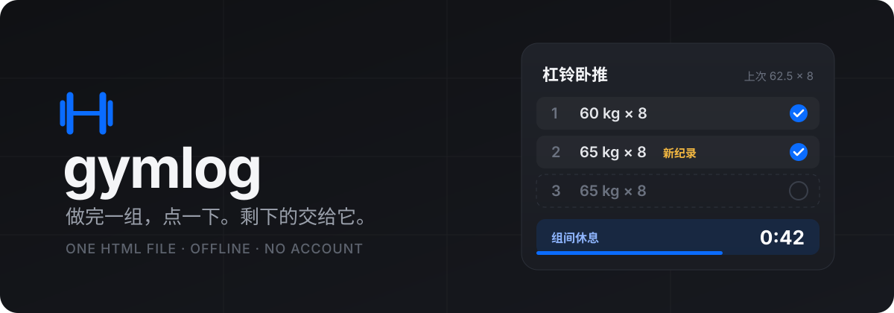

<p align="center">
  
</p>

<p align="center">
  <b>给不想数次数、也没有固定计划的人用的训练记录。</b><br>
  一个 HTML 文件，装到 iPhone 主屏幕就是 App。离线可用，不注册，数据不出手机。
</p>

<p align="center">
  <a href="https://faust-cloud.github.io/gymlog/"><b>打开使用</b></a> ·
  <a href="#截图">截图</a> ·
  <a href="#它是怎么做到的">实现细节</a> ·
  <a href="README.en.md">English</a>
</p>

<p align="center">
  
  
  
  
</p>

---

我试过几个健身记录 App，最后都没坚持下来。不是它们不好，是我的练法跟它们对不上：没有计划，哪个器械空着就练哪个；组间刷手机，经常忘了记；练完忘了点结束，第二天一看记了 15 个小时。

所以我照着自己的懒，写了这个。

## 截图

<p align="center">
  &nbsp;
  &nbsp;
  
</p>

## 它替你做的事

**记组只要点一下。** 新的一组自动沿用上一组的重量和次数，旁边写着上次同一组练了多少。做完点 ✓，休息倒计时自动开始。

**不想数就不数。** 点「没数」，按上次的次数记成「约 8 次」。估出来的组不会冒充纪录。

**忘了结束也没关系。** 10 分钟没动静就自动收尾，时长按最后一组完成的时间算。当天想接着练，点「继续这次训练」。

**没计划时帮你挑。** 选动作时，越久没练的排越前；首页写着胸、背、腿各几天没练。器械被占了，一键换成同部位的别的动作。

**休息结束会提醒，锁屏也会。** 侧边静音开关打开、手机放口袋、切到别的 App，到点都会「叮—咚」一声。不想打断音乐，可以换成只在前台提醒。

另外还有：热身组（照记，但不算进容量和纪录）、破纪录提示、每个动作的重量 / 估算 1RM / 容量曲线、按周统计、历史随时改、JSON 导出导入。

## 开始使用

1. 用 iPhone 的 **Safari** 打开 **[faust-cloud.github.io/gymlog](https://faust-cloud.github.io/gymlog/)**
2. 分享按钮 → **添加到主屏幕**
3. 以后都从主屏幕图标打开（它和 Safari 里的数据不互通）

没有信号的健身房也能用。新版本发布后，在「设置 → 检查更新」里更新。

> 数据存在手机浏览器里。清除 Safari 网站数据或删掉主屏幕图标，记录会一起消失。记得偶尔在「设置」里导出一份备份，超过 14 天没备份首页会提醒。

## 它是怎么做到的

整个应用是一个约 1200 行的 `index.html`，原生 JavaScript，没有框架、没有构建步骤、没有后端。另有一个几十行的 `sw.js` 负责离线缓存。

几个可能对你有用的做法：

- **锁屏也能响的提示音。** 网页在后台不能跑定时器。所以点 ✓ 的那一刻，用 JS 现场生成一段 WAV：前面是和休息时长一样长的静音，结尾是提示音，然后当作媒体开始播放。iOS 会让媒体在锁屏和静音模式下继续播，时间一到声音自然就出来了。代价是它会暂停你正在放的音乐，所以设置里留了「不打断音乐」模式。
- **倒计时不靠累加。** 只存结束时间戳，每次渲染算 `end - now`。被系统挂起、页面被杀掉重开，时间都是对的。
- **自动结束不靠后台。** 打开页面时检查距最后一次操作有多久，超过阈值就把结束时间回填为最后一组的完成时间。
- **数据可迁移。** `localStorage` 里的数据带版本号，结构变化在 `migrate()` 里逐级升级；每次写入失败会回滚，不会留下半截数据。

## 不打算做的

账号和云同步、社交、训练计划生成、AI 教练。它只负责在健身房里把这一组记下来。

## 已知限制

- 主要为 iPhone Safari 调过。Android 和桌面浏览器能用，但没有细测
- 界面只有中文，重量单位只有 kg
- 器械的重量是档位数字，换一台器械就没法直接比

## 本地运行

```bash
git clone https://github.com/Faust-cloud/gymlog.git && cd gymlog
python3 -m http.server 8000   # 打开 http://localhost:8000
```

直接双击 `index.html` 也能用，只是离线缓存不生效。

## License

[MIT](LICENSE)
